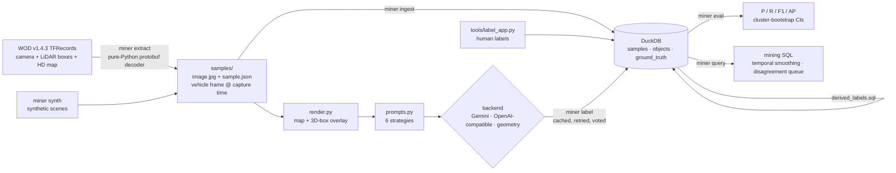

# scenario-miner

**VLM + 3D sensor/HD-map scenario mining and road-change detection on the Waymo Open Dataset.**

Simulation built from real driving logs is only as good as the scenarios you can find. This
project fuses camera frames with LiDAR 3D boxes and the HD map, asks a vision-language model
to tag each frame against a scenario taxonomy (construction zones, lane closures, emergency
vehicles, pedestrians in the roadway, …), stores everything in DuckDB for SQL mining, and
measures precision and recall against ground truth with honest confidence intervals.

The core experiment: **does grounding the VLM in 3D + map data ("prompt enrichment") improve
precision/recall over image-only prompting?** It compares six prompt strategies against a
geometric baseline.

## Pipeline



## Which dataset, and why

| Release | Camera | LiDAR 3D boxes | HD map | Verdict |
|---|---|---|---|---|
| **Perception v1.4.3** (TFRecord) | 5 cams | ✅ | ✅ lanes, road lines/edges, crosswalks, stop signs | **Used.** The only release with sensor + map together. |
| Perception v2.0.1 (Parquet) | ✅ | ✅ | ❌ "modular without maps" | Easier to read, but no map → no road-change detection |
| End-to-End Driving v1.0 | 8 cams | ❌ | ❌ | Camera-only; its scenario tags could be a second eval set later |
| Motion v1.3.1 | embeddings only | ✅ tracks | ✅ | No raw images for a VLM |

The official `waymo-open-dataset` pip package is Linux-only and pins TensorFlow, so
[`data/wire.py`](src/scenario_miner/data/wire.py) decodes TFRecords and the protobuf wire
format directly (field numbers from `dataset.proto`, `label.proto`, `protos/map.proto`). It
needs no TensorFlow or protoc and runs on macOS.

## Quickstart (no download, no API key)

```bash
make setup     # uv venv + editable install with all extras
make test      # 29 tests: geometry, decoder, pipeline, eval, real SDKs against a stub server
make demo      # synthetic scenes -> DuckDB -> geometric baseline -> eval report -> mining SQL
```

The demo's numbers only verify the wiring. Synthetic ground truth and the baseline share the
same cone-in-lane rule, so the baseline looks perfect on `road_change` by construction.

## Real data

```bash
source .venv/bin/activate
# 1. One time: register at waymo.com/open (accept the license), install gcloud, `gcloud auth login`.
scripts/fetch_and_extract.sh 30        # streams 30 validation segments; ~1 MB kept per frame
miner ingest && miner split            # DuckDB + derived ground truth; eval/few-shot splits
miner render --random 12               # CHECK: do cyan lanes sit on the painted lanes?

# 2. Human labels for the 3 semantic labels (~20 s/frame).
streamlit run tools/label_app.py -- --db data/miner.duckdb

# 3. Experiments.
export GEMINI_API_KEY=...
miner label --backend heuristic
for s in zero_shot cot few_shot map_overlay map_context map_overlay_context; do
  miner label --backend gemini --model gemini-2.5-flash --strategy $s
done
miner label --backend gemini --strategy map_overlay_context --votes 5   # self-consistency -> better AP
miner eval --baseline <zero_shot run_id>
miner query sql/mining_queries.sql
```

To run an open model locally instead, use any OpenAI-compatible server:
`miner label --backend openai --model qwen2.5vl:7b --base-url http://localhost:11434/v1` (Ollama).

## Experiment design

**Taxonomy** ([`taxonomy.toml`](src/scenario_miner/taxonomy.toml)). Only 3 of the 9 labels cost human time:

| Ground truth | Labels | Source |
|---|---|---|
| human | `construction_zone`, `road_change`, `emergency_vehicle` | `tools/label_app.py` |
| derived | `pedestrian_in_roadway`, `cyclist_nearby`, `large_vehicle`, `crowded_scene` | [`derived_labels.sql`](src/scenario_miner/sql/derived_labels.sql): exact rules over 3D boxes + map |
| stats | `night`, `rain` | WOD `context.stats` metadata |

The free labels double as a **canary**: if the VLM can't count pedestrians in the roadway
(where we know the answer exactly), don't trust it on lane closures.

**Strategies** ([`prompts.py`](src/scenario_miner/prompts.py)): `zero_shot`, `cot` (observations
before labels), `few_shot`, `map_overlay` (raw frame + projected map/boxes), `map_context` (raw frame +
text summary of the 3D scene), `map_overlay_context` (both).

**Metrics** ([`evaluate.py`](src/scenario_miner/evaluate.py)): per-label precision, recall, F1, and
AP from confidences; JSON-validity rate, latency and tokens per frame. Also a paired comparison
against a baseline run.

**Statistics that hold up:**
- *Cluster bootstrap over segments.* Frames 2 s apart on the same street are not independent, so
  frame-level resampling would give intervals that are far too tight.
- *Segment-disjoint few-shot pool.* An example frame can't be a near-copy of a test frame.
- *Visibility-conditioned derived GT.* A pedestrian behind the car isn't a miss for the front camera.
- *Paired bootstrap for ΔF1.* Both runs see the same resampled segments, so set-composition noise cancels.

## Results

_Fill in after the real-data runs. Report CIs; with ~100 frames they will be wide, and saying so is the point._

| strategy | construction_zone F1 | road_change F1 | emergency_vehicle F1 | macro-F1 (derived) | tokens/frame |
|---|---|---|---|---|---|
| geometry baseline | | | – | – | 0 |
| zero_shot | | | | | |
| map_overlay_context | | | | | |

## Geometry notes (the parts that bite)

- **Waymo's camera frame is x-forward, y-left, z-up**, not OpenCV's optical frame, so `u = f·(−y/x) + c`.
  Extrinsics are camera→vehicle.
- **Ego-motion compensation.** 3D labels are in the frame-pose vehicle frame, but each image has its
  own capture pose. Boxes and map are moved into the capture-time frame (`inv(image_pose) @ frame_pose`).
  At 15 m/s, a 10 ms offset is already 15 cm.
- **`map_pose_offset`** is added to world points to align them with the map, so map → vehicle is
  `inv(pose) @ (m − offset)`. The map is stored only in each segment's first frame.
- **Distortion folding.** Far outside the FOV, the radial polynomial turns over and maps points
  back *into* the image. Projection rejects points outside a padded undistorted FOV first
  (see `test_distortion_folding_is_rejected`).
- Rolling shutter is ignored (≤ a few px on the FRONT camera at city speeds).

## Layout

```
src/scenario_miner/
  geometry.py        SE(3), Waymo projection + distortion, polyline/polygon ops
  data/wire.py       TFRecord reader + protobuf wire decoder (no TensorFlow)
  data/waymo_v1.py   Frame -> samples: calibration, labels, map crop, ego-motion compensation
  data/synthetic.py  synthetic scenes through the same transform chain, with known GT
  features.py        per-object range, lane distance, crosswalk, camera visibility
  render.py          map + 3D-box overlays
  prompts.py         strategies, response schema, lenient parsing
  vlm.py             heuristic / Gemini / OpenAI-compatible backends
  pipeline.py        concurrent labeling with response cache and self-consistency voting
  store.py, sql/     DuckDB schema, ingest, derived labels, splits
  evaluate.py        P/R/F1/AP, cluster + paired bootstrap, markdown report
tools/label_app.py   Streamlit labeling UI
sql/mining_queries.sql
```

## Limitations / next

- WOD's 3D label set has no cone class, so the geometric baseline keys on generic "sign" boxes.
  The 3D semantic-segmentation labels (`TYPE_CONSTRUCTION_CONE`) on the subset of frames that have them
  would make a stronger baseline.
- Frame-level only. Scenario mining really wants time windows (`mining_queries.sql` #2 sketches this)
  and multi-camera fusion.
- Export mined windows as Waymax / scenario configs (real-to-sim).
- A C++/pybind11 kernel for LiDAR-point projection and frustum culling, benchmarked against NumPy.

Waymo Open Dataset content is covered by its own license: `data/` and `reports/` are git-ignored,
so don't publish frames without checking the terms.
